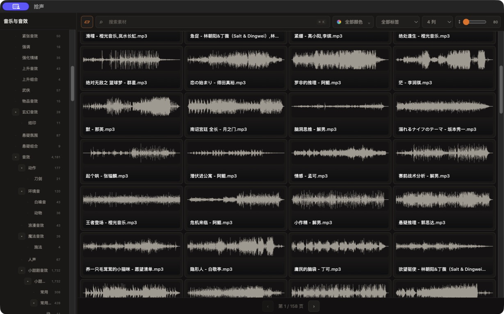
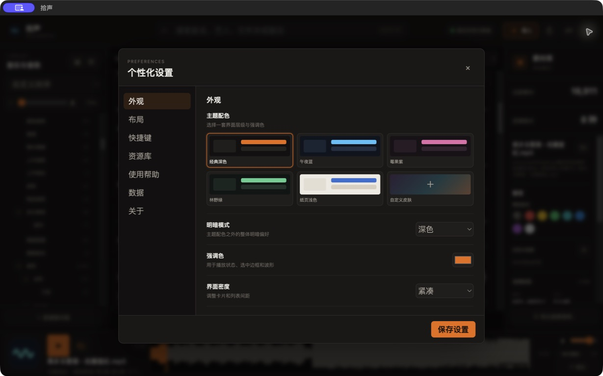
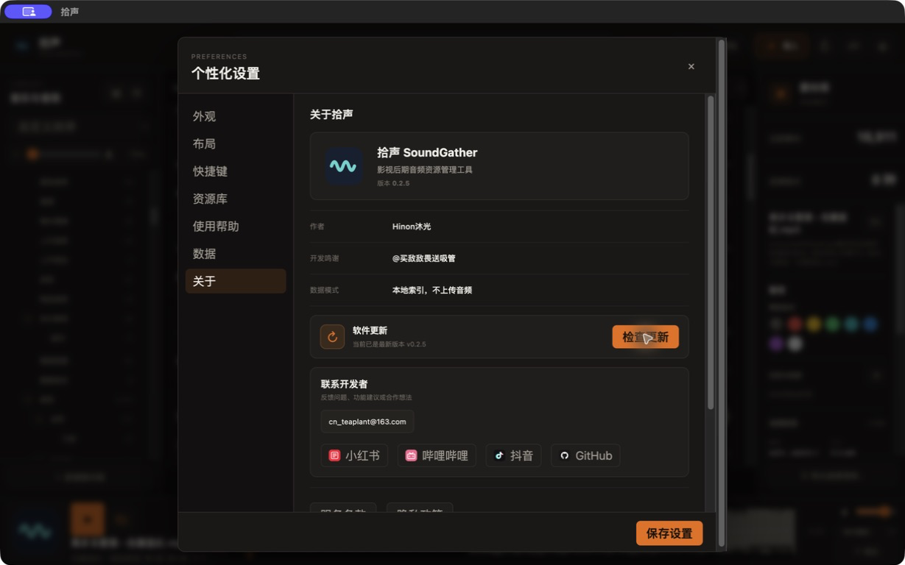

# 拾声 SoundGather

> 为影视后期工作者设计的本地音频资源管理工具  
> 快速整理、筛选、预览和调用庞大的音乐与音效素材库。

此仓库是拾声的**官方发布与下载页面**，用于保存正式安装包、版本说明和软件更新信息，不包含项目源代码。

## 快速下载

当前版本：**v0.2.5**

| 适用设备 | 下载文件 | 说明 |
| --- | --- | --- |
| Apple 芯片 Mac | [SoundGather-0.2.5-arm64.dmg](https://github.com/HinonCN/SoundGather-Releases/releases/download/v0.2.5/SoundGather-0.2.5-arm64.dmg) | 适用于 M1、M2、M3、M4 系列 Mac |
| Intel Mac | [SoundGather-0.2.5-x64.dmg](https://github.com/HinonCN/SoundGather-Releases/releases/download/v0.2.5/SoundGather-0.2.5-x64.dmg) | 适用于 Intel 处理器 Mac |
| Windows 64 位 | [SoundGather-Setup-0.2.5-x64.exe](https://github.com/HinonCN/SoundGather-Releases/releases/download/v0.2.5/SoundGather-Setup-0.2.5-x64.exe) | Windows 10/11 64 位安装程序 |

不知道 Mac 芯片类型时，请打开左上角 ** → 关于本机**：显示 Apple M 系列请选择 arm64，显示 Intel 请选择 x64。

[查看最新版本说明与全部安装包](https://github.com/HinonCN/SoundGather-Releases/releases/latest)

## 核心功能

- 本地导入音频文件与文件夹，不改变原始文件结构
- 素材箱分层管理、拖拽归类和自定义排序
- 大波形快速试听、点击定位、缩放与缓存
- 颜色标记、收藏、自定义标签和组合筛选
- 纯净素材模式，可与剪辑软件同屏并保持置顶
- 音频格式、大小、时长、采样率、声道、码率等详细信息
- 主题配色、自定义背景、区域缩放与快捷键设置
- 本地错误日志和 GitHub 新版本检查

## 软件界面

### 纯净素材模式

只保留素材箱、搜索、筛选与波形预览，最大化素材浏览空间，可与剪辑软件同屏使用。

### 个性化外观

内置多套主题配色，并支持自定义背景、强调色和界面密度。

### 关于、更新与诊断

在关于页面检查 GitHub 新版本、联系开发者，并导出本地诊断日志。

## 安装提示

### macOS

当前测试安装包尚未完成 Apple Developer ID 公证。首次打开如果被系统拦截：

1. 将“拾声”拖入“应用程序”文件夹。
2. 打开 **系统设置 → 隐私与安全性**。
3. 在安全提示区域选择 **仍要打开**。

### Windows

当前安装包尚未使用商业代码签名证书。Windows 可能显示“未知发布者”：

1. 在安全提示中选择 **更多信息**。
2. 确认文件来自本仓库后，选择 **仍要运行**。

请只从本仓库的 [Releases](https://github.com/HinonCN/SoundGather-Releases/releases) 页面下载安装包。

## 软件更新

拾声联网启动后会读取 GitHub 公共 Release 信息：

- 有新版本时，在软件内显示更新提醒
- 用户可跳转到 GitHub 查看说明并自行下载
- 当前不会静默下载或自动覆盖安装
- 不会上传本地音频、素材路径、标签或其他用户数据

## 数据与隐私

拾声采用本地索引模式。音频扫描、波形缓存、素材箱整理、标签和运行日志均保存在用户自己的电脑中。删除或移动软件内的虚拟素材箱不会修改本地原始音频文件。

## 问题反馈

遇到闪退、波形异常、导入失败或其他问题时，可以在软件 **设置 → 关于 → 导出诊断日志**，然后通过以下方式联系开发者：

- [提交 GitHub Issue](https://github.com/HinonCN/SoundGather-Releases/issues)
- 邮箱：[cn_teaplant@163.com](mailto:cn_teaplant@163.com)
- GitHub：[@HinonCN](https://github.com/HinonCN)
- [小红书](https://xhslink.cn/m/2XXBZPPLEbn)
- [哔哩哔哩](https://b23.tv/uWvp1eB)
- [抖音](https://v.douyin.com/lSMizv-hUoc/)

## 仓库与 Release 的区别

- **仓库主页（本页面）**：长期的产品介绍、下载导航、安装说明和联系方式。
- **Releases 页面**：每个版本独立的更新日志、安装包、发布时间和 SHA-256 校验信息。
- GitHub 自动生成的“Source code”压缩包只包含本发布仓库的说明文件，**不是拾声应用源码**。

## 开发者

- 作者：Hinon沐光
- 开发鸣谢：@买敌敌畏送吸管
- 当前阶段：持续完善中的公开测试版本
