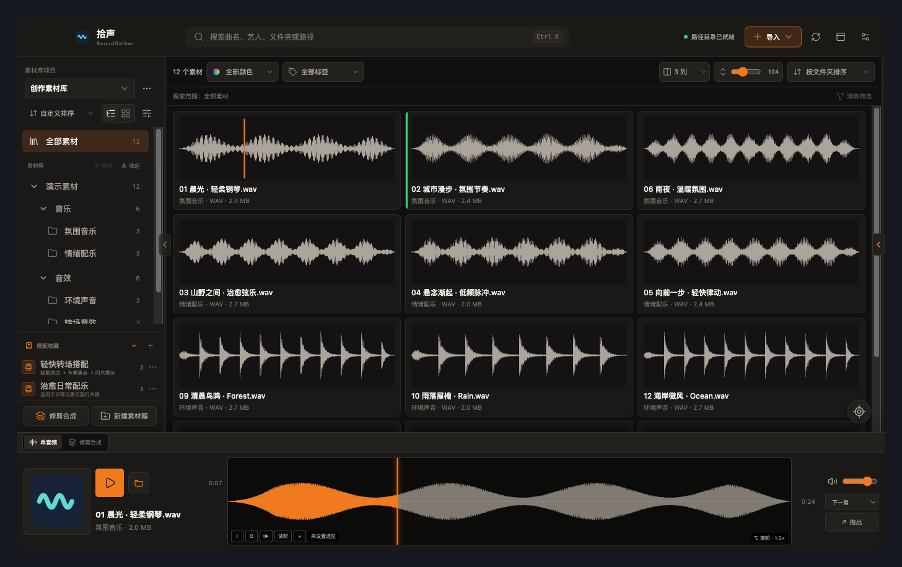
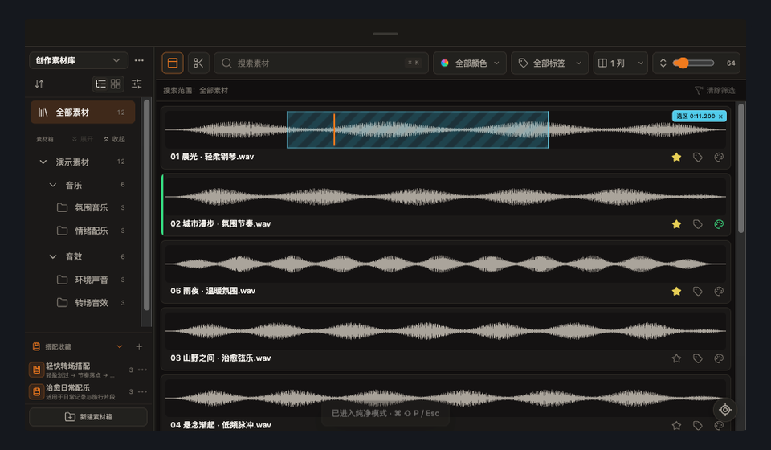
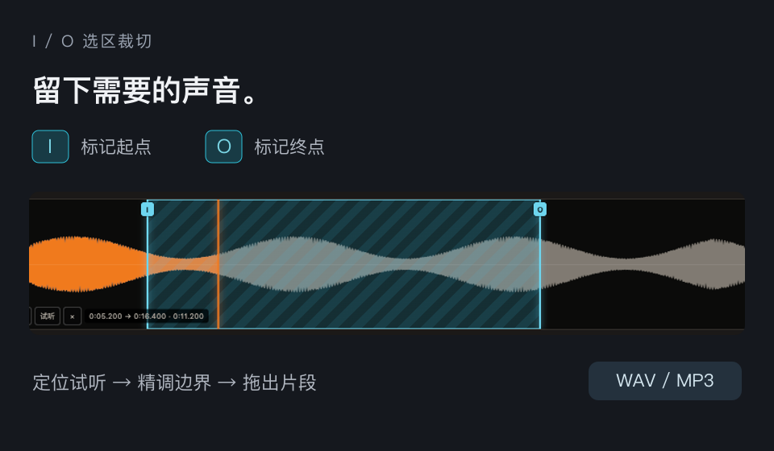
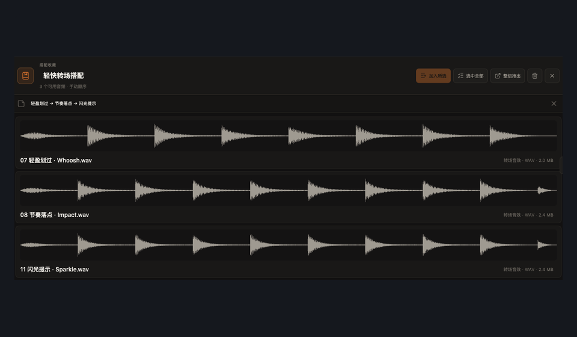
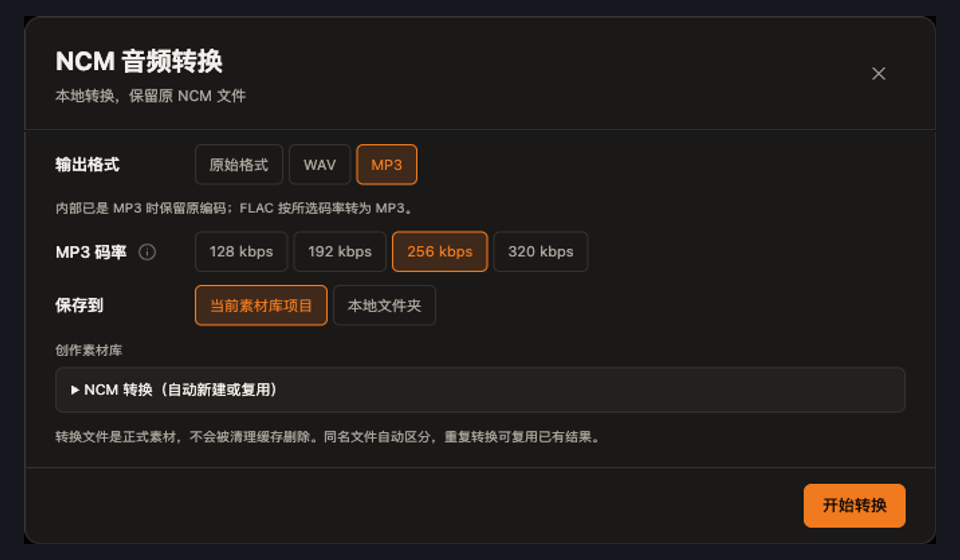

  

<h1 align="center">拾声 SoundGather</h1>

<strong>让音乐和音效素材，更好找、更好用。</strong>

为剪辑创作准备的本地音频素材库。看波形、听片段、存搭配，找到就能用。

  <a href="https://github.com/HinonCN/SoundGather-Releases/releases/latest">下载最新版</a> ·
  <a href="https://github.com/HinonCN/SoundGather-Releases/releases/tag/v0.3.0">0.3.0 更新内容</a> ·
  <a href="https://github.com/HinonCN/SoundGather-Releases/issues">反馈与建议</a>

  

## 下载使用

| Apple 芯片 Mac | Intel Mac | Windows |
| :---: | :---: | :---: |
| [下载 arm64 安装包](https://github.com/HinonCN/SoundGather-Releases/releases/download/v0.3.0/SoundGather-0.3.0-macOS-arm64.dmg) | [下载 x64 安装包](https://github.com/HinonCN/SoundGather-Releases/releases/download/v0.3.0/SoundGather-0.3.0-macOS-x64.dmg) | [下载 64 位安装包](https://github.com/HinonCN/SoundGather-Releases/releases/download/v0.3.0/SoundGather-Setup-0.3.0-Windows-x64.exe) |
| macOS 13.0+ · M 系列芯片 | macOS 13.0+ · Intel 芯片 | Windows 10 / 11 |

当前安装包为 0.3.0 正式版。[查看最新版本](https://github.com/HinonCN/SoundGather-Releases/releases/latest) · [SHA-256 校验文件](https://github.com/HinonCN/SoundGather-Releases/releases/download/v0.3.0/SoundGather-0.3.0-SHA256.txt)

## 你的素材，随用随取

导入文件或文件夹 → 搜索与波形试听 → 标签、归类或收藏 → 拖入剪辑软件。

<table>
  <tr>
    <td width="50%" valign="top">
      <h3>少切窗口，专注试听</h3>
      
纯净模式置顶浏览。搜索、筛选和波形集中在一个小窗口，与剪辑软件同屏使用。

      
    </td>
    <td width="50%" valign="top">
      <h3>只取需要的那一段</h3>
      
按 I / O 标记起止点，精调并试听。拖出时生成 WAV 或 MP3，保留原始音频。

      
    </td>
  </tr>
  <tr>
    <td width="50%" valign="top">
      <h3>记住一组好用的搭配</h3>
      
把常用音乐和音效存为搭配收藏，排序、备注，下次整组拖出，仍是独立音频。

      
    </td>
    <td width="50%" valign="top">
      <h3>转换后，直接入库</h3>
      
本地批量转换 NCM，自选原始格式、WAV 或 MP3。存入素材库，也可另存到文件夹。

      
    </td>
  </tr>
</table>

更多功能

- 项目隔离：为不同工作建立独立素材库，自定义存储位置。
- 素材整理：多级素材箱、拖拽归类、批量标签、收藏与颜色标记。
- 搜索与定位：按名称、艺人、文件夹和路径查找，支持搜索历史与定位当前播放音频。
- 工程交接：按素材箱层级复制文件，并生成 .sgproject 工程，便于跨电脑导入复用。
- 修剪合成：在底部时间线排列、修剪和调整淡化，另存为单条 WAV 或 MP3。
- 个性化：主题、背景、卡片布局、波形高度以及键盘和鼠标快捷键。
- 缓存管理：查看和清理波形、兼容音频与界面缓存。

安装说明与软件更新

Mac：打开 DMG，将“拾声”拖入“应用程序”。可在“ → 关于本机”查看芯片类型。当前安装包使用本地签名，尚未经过 Apple Developer ID 公证；如被拦截，可在“系统设置 → 隐私与安全性”中确认打开。

Windows：打开 EXE，按安装向导选择位置。当前安装包未配置发布者数字签名，如出现 SmartScreen 提示，请先确认文件来自本仓库。

请下载上方对应设备的安装包；GitHub 自动生成的 Source code 压缩包不是安装程序。软件内可检查正式版和测试版更新、查看说明并下载安装包，安装由用户确认。

## 本地管理，安心整理

音频索引、标签、收藏和缓存保存在本机，不上传音频。素材箱与搭配收藏只保存整理关系；裁切、转换和合成会另存文件，不修改源音频。

有问题或建议，欢迎 [提交 Issue](https://github.com/HinonCN/SoundGather-Releases/issues)，或联系 [cn_teaplant@163.com](mailto:cn_teaplant@163.com)。运行问题可附上软件版本、操作步骤及设置中导出的诊断日志。

[小红书](https://xhslink.cn/m/2XXBZPPLEbn) · [哔哩哔哩](https://b23.tv/uWvp1eB) · [抖音](https://v.douyin.com/lSMizv-hUoc/)

作者：Hinon沐光 · 开发鸣谢：@买敌敌畏送吸管

本仓库用于官方版本发布、安装包下载与更新信息，不包含应用源代码。截图使用 0.3.0 与示例音频。
